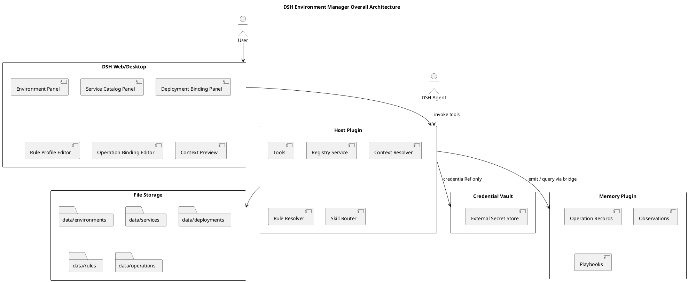

# DSH Environment Manager Design

## Overview

DSH Environment Manager is a DSH plugin that provides shared enterprise environment and service context to every session in a profile.

It supports:

- Environment, host, cluster and role registry
- Service catalog with Git/artifact metadata
- Deployment bindings across native, Docker and Kubernetes runtimes
- Layered, provenanced rule resolution
- Deterministic operation-to-skill routing
- Optional memory bridge integration

## Architecture Principles

```text
File-based registry is the source of truth.
Skill routing is explicit and conflict-aware.
Credentials are references; values live elsewhere.
Write operations and production access require approval.
Memory stores the lesson; this plugin stores the context.
```

## Overall Architecture



## Main Flow

### Context Resolution Flow

```text
Agent request
→ Tool validation
→ Load registry files
→ Resolve environment, service, deployment
→ Apply rule layers
→ Build Service Context
→ Return with provenance
```

### Operation Routing Flow

```text
Agent request (environmentId, serviceId, operation)
→ Resolve service context
→ Match operation bindings by priority
→ Detect conflicts
→ Verify skill availability
→ Evaluate approval policy
→ Return skill reference + parameters
```

### Memory Bridge Flow

```text
Operation completes
→ Build Operation Record
→ Sanitize evidence
→ Emit to memory bridge
→ Optionally generate candidate proposal
→ Push proposal to review queue
```

## Key Data Files

Registry:

```text
data/
├── environments/
│   └── {environmentId}.yaml
├── services/
│   └── {serviceId}.yaml
├── deployments/
│   └── {deploymentId}.yaml
├── rules/
│   └── {ruleProfileId}.yaml
└── operations/
    └── {bindingId}.yaml
```

## Security Boundary

- The plugin may only read/write under its configured data directory.
- Credential values must never enter this plugin; only `credentialRef` references are stored.
- Production-flagged operations require explicit user approval before execution.
- Rule templates must not execute arbitrary JavaScript or shell code.
